# Saiyuuki World → Vietnamese: the complete technical walkthrough

*Game:* **Saiyuuki World** (西遊記ワールド, NMK/Jaleco, Famicom 1988) · *Input ROM:* `Saiyuuki_World_Japan.nes`, md5 `01e8594637accca56e7d1a2e63906db5` · *Output:* `saiyuuki_vi.nes` (256 KB) + `saiyuuki_vi.ips`

This document records **every step, finding, decision and bug** of the translation, with the numbers needed to reproduce it. A gentler introduction for newcomers is in `02_TUTORIAL_FOR_BEGINNERS.md`; reusable guidance for AI assistants is in `skill/nes-vietnamese-translation/`.

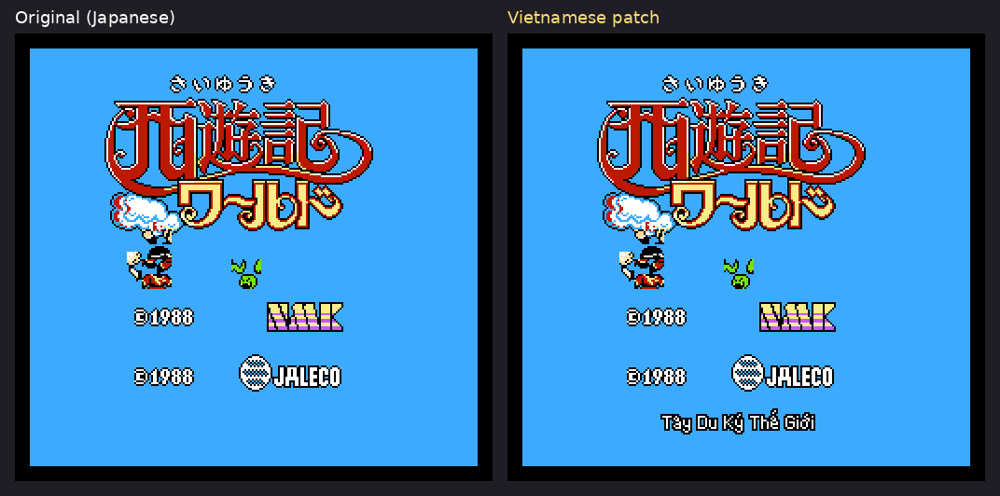

---

## 0. Requirements and what they imply

| # | Requirement from the brief | Technical consequence |
|---|---|---|
| 1 | Full Vietnamese tone marks; text must never be mis-aligned or overflow the dialog box | The 8×8 kana font cannot carry diacritics (a Vietnamese letter needs up to 3 stacked marks) → a **new rendering path** with taller proportional glyphs; hard per-line pixel budget enforced at build time |
| 2 | Sino-Vietnamese (Hán–Việt) vocabulary where fitting | Translation style guide + glossary (§13) |
| 3 | ROM modification / expansion allowed | Expand UNROM 128 KB → 256 KB, add code + data banks (§8) |
| 4 | Translate the title screen; if the logo graphic cannot be edited, add simple Vietnamese text below it | Logo is composed from BG tiles that are RLE-compressed; keep it and add a text line with a runtime hook (§12) |
| 5 | Document everything | This file, the tutorial, the skill, plus all scripts in `tools/` and `src/` |

---

## 1. Environment and tools

Nothing but free tools was needed.

| Tool | Purpose | Where |
|---|---|---|
| Python 3 + Pillow, matplotlib | analysis scripts, bitmap fonts, builder, figures | `tools/*.py` |
| Node.js + **jsnes** (`git clone https://github.com/bfirsh/jsnes`) | *headless* NES emulator: screenshots, VRAM/RAM dumps, memory-access traces, savestates | `tools/*.mjs` (they `import` jsnes from `/home/claude/vendor/jsnes`; change the path or set `JSNES`) |
| `tools/dis6502.py` | 6502 disassembler written for this project | `dis6502.py rom bank start end` |
| `tools/asm6502.py` | two-pass 6502 assembler written for this project (no assembler was installed) | `asm6502.py file.asm origin` |
| `tools/make_ips.py` | IPS patch writer (verified by re-applying) | |

No hardware, no GUI debugger. Everything is scriptable, which also makes the process reproducible and AI-friendly.

---

## 2. Anatomy of the ROM

### 2.1 iNES header (16 bytes)

```
4E 45 53 1A | 08 | 00 | 21 | 08 | 20 | 00 | 00 | 07 | 00 00 00 01
 "NES" EOF   PRG  CHR  f6   f7   b8   b9   b10  b11
```
* PRG = 8 × 16 KB = 128 KB. CHR = 0 → **CHR-RAM**: the game has no graphics ROM; it copies tiles into the PPU at run time from compressed data inside PRG.
* f6=`$21`, f7=`$08`: mapper = `2` (low nibble of f6 = 2, high nibble of f7 = 0) and NES 2.0 format. Byte 8 `$20` = submapper 2 (bus conflicts: AND-type), byte 11 `$07` = CHR-RAM of 64<<7 = 8 KB.
* After the patch only byte 4 changes (8 → 16).

### 2.2 Mapper 2 (UNROM)

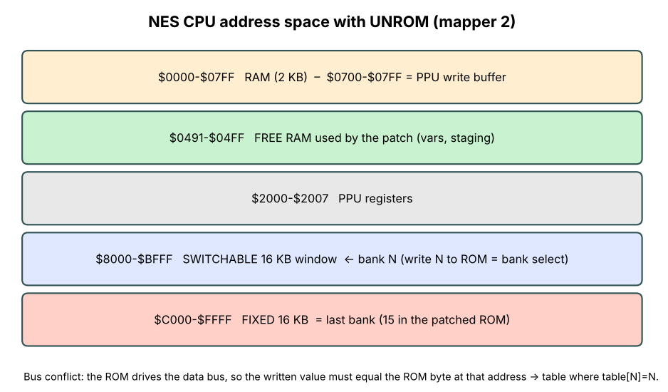

Writing a value N anywhere in `$8000-$FFFF` selects bank N for the window `$8000-$BFFF`; `$C000-$FFFF` always shows the **last** bank. Because the ROM chip drives the data bus at the same time as the CPU, the written value must equal the ROM byte at that address ("bus conflict"). The game solves this with a **table in the fixed bank** at `$FF5F` where `table[N] = N`; the bank-switch routine at `$FCAA` does `STA $FF5F,X` with `X = A = bank`.

The routine also does `CMP $8000` first (skip the switch if already selected) – which only works because **every bank starts with a byte equal to its own number**. `lab1_header.py` shows this: bank 1 starts `01 00 32 80`, bank 2 `02 …`. *Any new bank must follow this convention.*

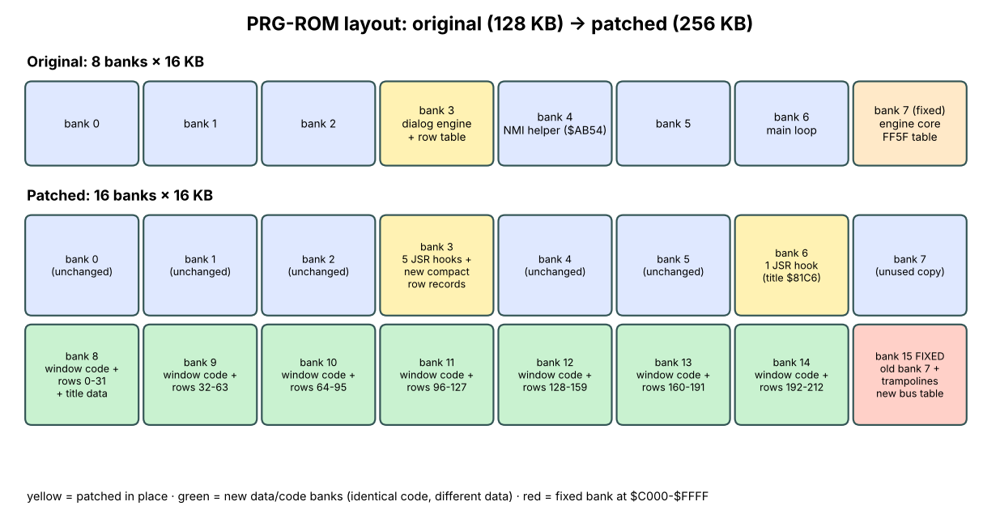

### 2.3 Where things are (original ROM)

| What | Where | How found |
|---|---|---|
| Fixed bank (engine core) | bank 7 @ `$C000` | last bank |
| NMI handler | `$C100` (vector at `$FFFA`) | read vectors |
| PPU enqueue routine | `$FD1E` (entry via jump table `$FF76`) | traced `$2007` writes back to the caller |
| Bank switch | `$FCAA` | callers of `STA $FF5F,X` |
| Dialog engine | bank 3 `$AB0B-$ACF7` | PC sampling while a dialog is open |
| Dialog table | bank 3 `$9E77` (213 pointers) + records `$A021-$AB0A` | searching for kana tile codes |
| Main loop | bank 6 `$8100-$81D7` | PC sampling on the title screen |
| Free ROM | fixed bank `$C02A-$C0FF` (214 B of `$FF`), `$FF32-$FF5E` (45 B) | scan for runs of `$FF` |
| Free RAM | `$0491-$04FF` | write-tracking during dialogs, shop, menu |

---

## 3. Finding and decoding the text

### 3.1 Graphics first: dump the font

A CHR-RAM game gives no tiles to look at in the ROM, so run it and dump the PPU:

```bash
node docs/examples/lab2_vram_dump.mjs rom/original.nes 200 work/t 150      # frames, prefix, START at frame 150
python3 docs/examples/lab2_tiles.py work/t.vram tiles.png 3
```

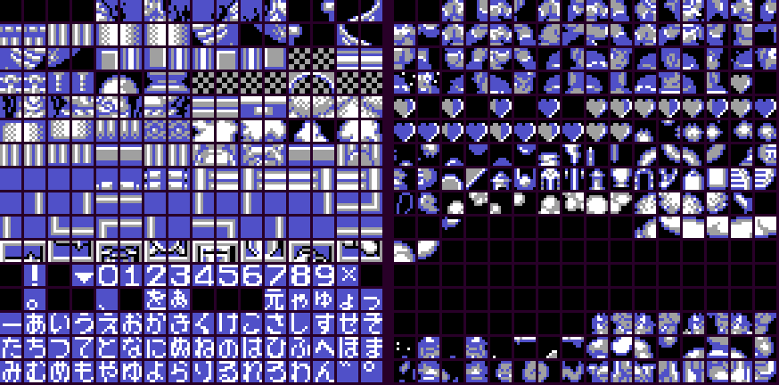

*Left* = background pattern table `$0000`, *right* = sprite table `$1000` (`PPUCTRL` bit 4/3 tells which is which; here BG uses `$0000`). The kana font is the block at the bottom of the left table: tile index = row·16 + column, so row 11 (`$B0…`) holds blank, `!`, `▼`, digits `0-9`, `×`; rows 13-15 hold hiragana `あいうえお…`.

### 3.2 The tile → character table (`tools/jtable.py`)

The text is **hiragana only** (no kanji), encoded as one tile code per character:

| Codes | Characters |
|---|---|
| `$B0` | space · `$B1` `!` · `$B3` ▼ (wait-for-button marker) · `$BE` × |
| `$B4-$BD` | digits 0-9 |
| `$C1` 。 `$C4` 、 `$C6` を `$C7` ぁ `$CB` 元 `$CC-$CF` ゃゅょっ `$D0` ー |
| `$D1-$FD` | あいうえお かきくけこ さしすせそ たちつてと なにぬねの はひふへほ まみむめも やゆよ らりるれろ わん (in that order) |
| `$FE` `$FF` | ゛ (dakuten) and ゜ (handakuten) as **separate tiles** – "ど" is `$E4 $FE` (that is why `lab3_text.py` shows `ありか゛とう` for ありがとう) |

Derivation: match the dumped tile pictures to the hiragana gojūon order, then validate by decoding the dialog table and checking that the output is readable Japanese.

### 3.3 The dialog table (`tools/extract_script.py`)

```
$9E77 : 213 × little-endian pointer  →  record
record: [flags][len]([addrLo][addrHi] if flags&$10)[len tile codes]
```
`extract_script.py` prints all 213 rows; `lab3_text.py` is a 25-line version for learning. Row groups discovered:

| Rows | Content | Flags |
|---|---|---|
| 0-6 | shop greetings (row 0 = 20 spaces, used to blank a line) | `$00` |
| 7-33 | item / weapon / armor names | `$08` (table position) or `$00` |
| 34-153 | NPC and boss dialogue, quiz, zodiac hints | `$E0 $C0 $60 $40 $00` |
| 154-178 | price numbers (digit tiles) | `$08` |
| 179-182, 197-198 | inventory item names | `$08` |
| 183-188 | status-screen labels (explicit addresses `$2061 $2175 $2165 $2094 $206D $2077`) | `$30/$10` |
| 189-196, 199-202 | misc dialogue, enemy names | |
| 203-212 | one-line banners (explicit address `$2101`, up to 28 chars) | `$10` |

The Japanese script with flags is exported in `work/rows_jp.json`; the bilingual table is `docs/translation_table.md`.

---

## 4. Reverse-engineering the dialog engine

### 4.1 Method

1. **Find who writes `$2007`** (PPU data) with `tools/pputrace.mjs`; the writes come from the NMI routine at `$C1F2`. The NMI reads a **queue** in RAM `$0700`.
2. **Find who fills the queue** with `tools/callsites.mjs` (logs the return address of every call to `$FD1E`).
3. **Sample the program counter** (`tools/pcsample.mjs`) while a dialog is open → the hot loop is in bank 3 around `$AB0B`.
4. **Disassemble** (`dis6502.py rom 3 AB0B ACFA`) and annotate by experiment (poke RAM, watch the screen).

### 4.2 The PPU write queue

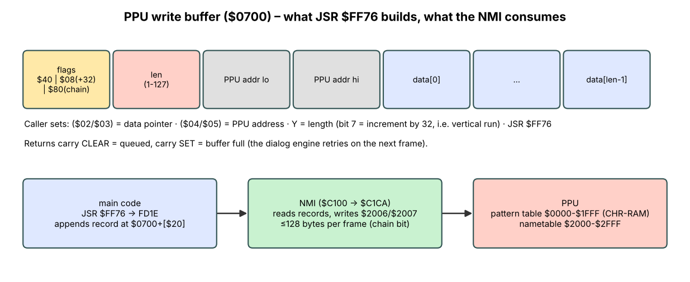

`JSR $FF76` → `$FD1E`. Inputs: `($02)` data pointer, `($04/$05)` PPU address, `Y` length (`$80` bit = add 32 per byte, a vertical run). It stores `[flags][len][addrLo][addrHi][data…]` at `$0700 + [$20]`, increments the record counter `$1E`, and **returns carry set if the 256-byte queue is full** (and the screen is off).  `FEFB` sets the *chain* bit so that the NMI keeps consuming records while the data total stays < 128 bytes – the NMI therefore moves **at most ~128 bytes per frame** (VBlank budget).  All text, tile uploads and attribute writes use this one path, which makes it a perfect interception point.

### 4.3 The row engine, annotated

Called once per frame while text is active. `$50` bit0 = "a row is being typed", `$51` row index, `$52` position index, `$53` step count, `$54` current column, `$55` timer, `$56` last column, `$57/$58` pointer to the next char, `$59` flags/state, `$0429` bit 5 = "retry needed", bit 6 = button pressed.

```
AB0B  JSR $AD2C          ; poll the A button -> $0429 bit6
AB0E  JSR $ACB5          ; ($04/$05) = $2146 (line 0) or $2186 (line 1, if $59 bit3)
AB11  LDA $50 / AND #1 / BEQ new_row   ; row in progress? else go ABD8 (tick it)
 new_row (AB1A..):
      $51*2 + $9E77 -> pointer -> ($02)               ; row record
      $59 = ($59 & $0F) | flags
      flags & $08 ? ($04/$05) = $AD0C[$52 & 15]       ; table position
      $53 = $56 = len ; flags&$40 ? $53 = 1           ; typewriter draws 1 char
      flags & $10 ? ($04/$05) = addr from record
      JSR $ACAB (x1 or x2): ($02) += 2 / 4            ; skip header
AB96  JSR $FF76          ; *** HOOK 1 (T_INIT): draw the row / first char ***
      BCC ok / else $0429|=$20 ; RTS                  ; retry next frame
      chain? $20: INC $51 ; JMP AB0B ; else end
 typing (ABD8..):
AC01  INC $55 ; every 8th frame:  $04 += $54 ; ($02)=($57)
AC1B  JSR $FF76          ; *** HOOK 2 (T_STEP): draw column $54 ***
AC23  last column? (CMP $54,$56)
AC32  last char == $B3 (▼)?  -> set blink state ($59 bit2)
 blink (AC85..):
ACA3  JSR $FF76          ; *** HOOK 3 (T_BLINK): erase the ▼ column ***
 clear (ACC6..):
ACD9  JSR $FF76          ; *** HOOK 4 (T_CLEAR): wipe line 0 ***  ($ACF8 = 20 zeros)
ACE7  JSR $FF76          ; *** HOOK 4 again: wipe line 1 ***
```
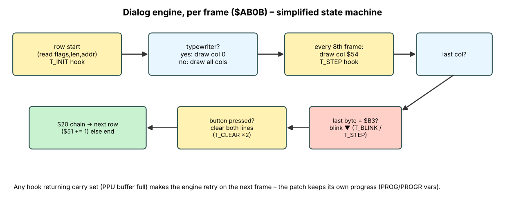

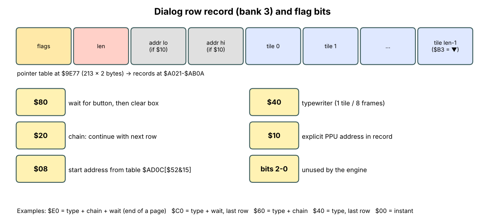

Two facts make the patch cheap:

* The engine **only inspects `data[len-1]`** (the `$B3` test at `$AC34`). Everything else about the row is *where* it is drawn and *how many steps* it has.
* A *step* is one tile column (8 px). Vietnamese text can be drawn in the same number of steps as columns of pixels.

---

## 5. Screen inventory

| Screen | How text arrives | Geometry | Notes |
|---|---|---|---|
| **Dialog box** (NPC, bosses, hints) | rows with `$40`-`$E0` flags | tile rows 10-13, cols 6-25 (20 tiles) | box interior; row 13's lower 4 px is the border |
| **Shop** | same box; item name printed as flag-`$08` row at position 0; prices via digit tiles at `$20E7`/`$20F7` | | prices (rows 154-178) and 元 are left untouched |
| **Status (Select)** | explicit-address labels + slots at `$21B5…` | one tile row | needs the 8-px font |
| **Banner** (rows 203-212) | explicit address `$2101` | 28 chars | not reachable in my tests – verified by direct hook call |
| **Title** | tiles written once at boot | | no text engine involved |

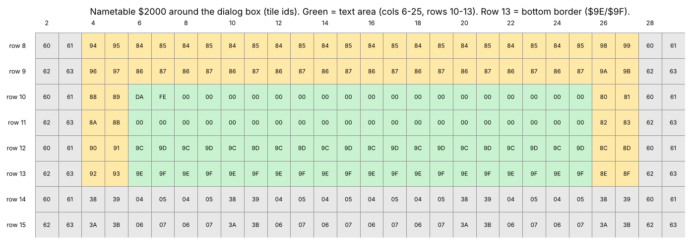

Colour model of the font tiles (palette 0 of the box): **ink = colour 1 (white), background = colour 3 (black), box border = colour 2 (blue)**. Row 13's tile `$9E/$9F` has the border in pixel rows 4-6 (`2,1,2`) and background in rows 0-3 and 7. Tile `$9C` is the plain background tile, `$00` is colour 0 (also black).

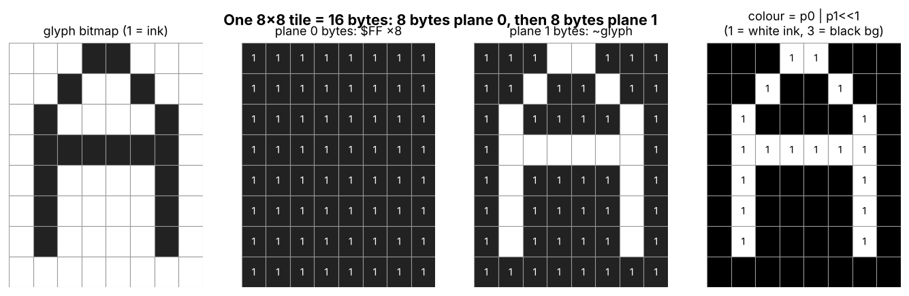

---

## 6. Design: why bitmaps in pooled tiles?

Options considered:

| Option | Verdict |
|---|---|
| Re-draw the 8×8 font as Vietnamese letters, keep 1 byte per char | ✗ 134 letter+tone combos × 2 cases ≫ 80 tiles; 8 px cannot hold marks |
| Add a second font with only the letters used | ✗ the *set of tiles* is still limited to ~70 free tiles and rows share tiles; heavy manual layout |
| **Pre-render each line as pixels, split into 8-px columns, upload the needed tiles when a column is shown** | ✓ any text, proportional glyphs, true diacritics; costs only ROM data and a pool of 68 tiles |

**Pool.** The dialog needs no kana tiles any more except digits, `×` and 元 (the shop still draws prices). Of the 80 font tiles `$B0-$FF`, 12 are kept (`$B4-$BD` digits, `$BE` ×, `$CB` 元) → **68 pool tiles** in three contiguous runs `$B0-$B3`, `$BF-$CA`, `$CC-$FF` (each an even length, so tile *pairs* are adjacent). 68 tiles = 34 pairs = **2 lines × 17 columns**.

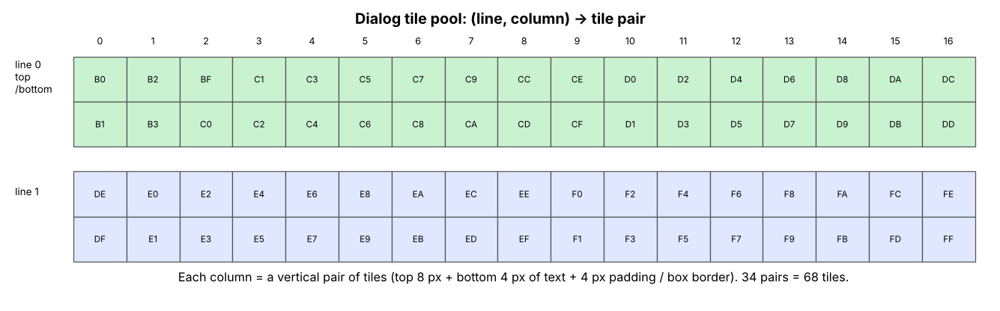

*Safety check:* the tiles in `$B0-$FF` are not used by gameplay graphics (the kana were never overwritten by stages). Verification: after a status-screen visit, compare VRAM before/after (`ui_test.mjs` + diff): the game restores most pool tiles by itself; `$BF-$CA` stay dirty but are not referenced by any stage nametable; frames of normal gameplay were pixel-identical to the original build.

**Geometry of a line.** One *line cell* = 16 px tall = 2 tile rows. Text occupies pixel rows 0-11; rows 12-15 are padding, except for line 1 whose last 4 pixel rows reproduce the bottom border (`B1P0/B1P1` constants). Width = 17 columns = **136 px**, starting at nametable column 7 (`$2147` for line 0, `$2187` for line 1); a `▼` consumes the 17th column, so a wait-row's text is limited to **128 px**.

**Per-column draw** (what `draw_step` does):

1. `STAGE[0..7] = $FF` (plane 0), `STAGE[8..15] = ~bitmap[0..7]` (plane 1; ink = 0) → tile *top*.
2. `STAGE[16..23]` / `[24..31]` the same for pixel rows 8-11 plus padding/border → tile *bottom*.
3. Enqueue `STAGE` (32 B, one record) at PPU address `tile*16` (CHR-RAM).
4. Enqueue the two nametable bytes `(top, bottom)` as a vertical run at `$2147+col`/`$2187+col`.

---

## 7. The Vietnamese fonts

### 7.1 12-px proportional font (`tools/viet_font.py`)

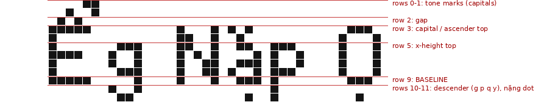

* **Cell = 12 rows**: rows 0-1 tone marks of capitals, row 2 gap, rows 3-9 capitals/ascenders (baseline row 9), x-height starts at row 5, descenders rows 10-11 (g j p q y), dot-below (nặng) at row 11.
* **Composition**: 5×7 base capitals, 4-5 px lowercase, digits and punctuation are hand-drawn dictionaries; marks (`acute grave hook tilde circ breve horn`, đ bar, dot below) are *placed by rule* so all 134 Vietnamese vowel/tone combinations exist without drawing each one. For a capital with circumflex + tone the two marks sit **side by side** (no vertical room). `unicodedata.normalize('NFD')` splits any precomposed character.
* Advance width = glyph width + 1, so text width in px is known exactly (`text_width`) → build-time overflow check.

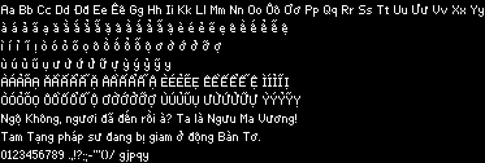

### 7.2 8-px all-caps font (`tools/viet_font8.py`)

The status screen only has one tile row per label: a compact 3×5 capital font, marks in rows 0-1, body rows 2-6, dot-below row 7. Combined marks (Ệ, Ể…) are the weak spot, so the labels were *chosen* to avoid them: **MẠNG / BẠC / CÔNG / VŨ KHÍ / BẢO VẬT** (an earlier draft MỆNH / TIỀN / ĐIỂM was unreadable at 8 px).

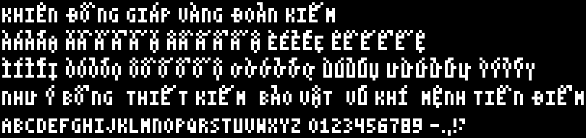

---

## 8. Expanding the ROM

1. `PRG = 16 banks`: banks 0-6 unchanged; **old bank 7 is copied twice** – into slot 15 (the new fixed bank) and slot 7 (never mapped in practice, kept so a stray bank-7 select still shows valid code).
2. New banks 8-14 start with their bank number byte (see §2.2).
3. **New bus-conflict table** `BUSTAB` at `$C02A` (16 entries 0..15). The four code sites that referenced `$FF5F` are repointed: `C15B C164 FCA6 FCBA` (`9D 5F FF` → `9D 2A C0`).
4. Header byte 4 = 16.
5. jsnes' mapper-2 loads `romCount-1` at `$C000`, so no emulator change was needed. For real hardware/FPGA, 256 KB UNROM (iNES mapper 2) is standard (e.g. UxROM boards with 4-bit register).

Fixed-bank free space used: `$C02A-$C0D0` (bus table + trampolines, 167 bytes of 214 available).

---

## 9. The 6502 code

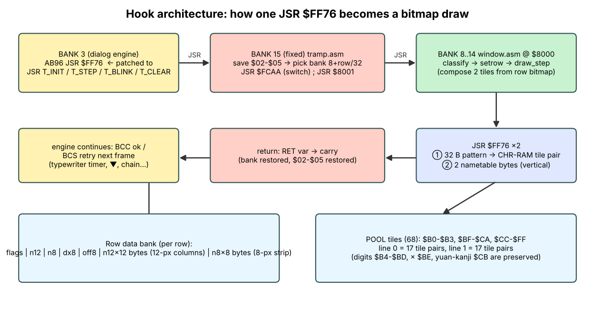

### 9.1 Patch sites

| Site | Original | New | Purpose |
|---|---|---|---|
| bank 3 `$AB96` | `JSR $FF76` | `JSR T_INIT` (`$C03A`) | row start |
| bank 3 `$AC1B` | `JSR $FF76` | `JSR T_STEP` (`$C04F`) | typewriter column |
| bank 3 `$ACA3` | `JSR $FF76` | `JSR T_BLINK` (`$C053`) | ▼ blink-off |
| bank 3 `$ACD9`, `$ACE7` | `JSR $FF76` | `JSR T_CLEAR` (`$C057`) | clear line 0 / line 1 |
| bank 6 `$81C6` | `JSR $C4A2` | `JSR T_MAIN` (`$C05B`) | title-screen text, every frame |
| fixed `C15B C164 FCA6 FCBA` | `STA $FF5F,X` | `STA $C02A,X` | 16-entry bank table |

### 9.2 Trampolines (`src/tramp.asm`, fixed bank)

`T_INIT` first lets **price rows (154-178) and the 元 row (186) pass through** to the original `JMP $FF76` (their digits live in preserved tiles). Everything else loads `X = mode` and falls into `common`:

1. Save the engine's `$02-$05` in RAM (`SAV02..`) – the engine needs them intact after the call – and copy `$04/$05` to `SAV04/05` (the destination address the engine wanted).
2. Pick the bank: modes 0/1 → `8 + row/32` (`$51 >> 5`); modes 2/3/4 need no row data → bank 8.
3. `JSR $FCAA` (switch; returns the old bank in A), `PHA`, `JSR $8001`, `PLA`, `JSR $FCAA` (restore). The engine's `$10` ("current bank") is updated by `$FCAA` itself, which matters because the NMI re-selects `$10` after its own bank-4 call.
4. Restore `$02-$05`, copy `RET` bit 0 into carry (1 = buffer full → engine retries) and `RTS`.

`T_MAIN` (title): if `$FD == 3` (title idle; observed values: 3 only during the title) and `TDONE == 0`, call mode 4 each frame until it reports done; otherwise reset `TDONE/TPOS`. Then `JMP $C4A2` (the replaced call).

### 9.3 Window code (`src/window.asm`, identical in banks 8-14 at `$8000`)

* `$8000` bank id, `$8001 JMP entry`, `entry` at `$8010` dispatches `MODE` 0-4. Row pointer table `ROWTAB` at `$8600` (32 × 2 B), row records from `$8640`.
* `classify` → `CLS`: `0/1` dialog line 0/1 (destination `$21xx` with `lo & $E0 = $40/$80`), `2` strip slot (looked up in `SLOTS`), `3` banner (`$2101`), `$FF` unknown (draw nothing).
* `setrow` reads the 6-byte header **`flags | n12 | n8 | dx8 | off8(2)`** (flags: bit0 = 12-px bitmap present, bit1 = 8-px strip present, bit7 = blank row) and computes pointers to the 12-px data (`rec+6`, 12 bytes per column) and 8-px data (`rec+off8`, 8 bytes per column).
* `draw_step` = §6 per-column draw; `tilepair` is the shared composer; `draw_big` (banner) uses pool pairs `0..27`; `draw_small` (status strips) writes **one 8-px tile** per column from `SPOOL` (68 single tiles) at `SAV + DX8 + col`.
* **Retry support**: if `ENQ` fails mid-row (queue full) the progress is saved in `PROG`/`PROGR`; the engine re-enters the row start next frame and resumes. Observed during menu start-up (about 20 frames of retries while the screen is still fading in).
* Mode 3 (`clear_line`) writes 20 blank tiles `$9C` on both tile rows of a line (`$9E` on row 13 to rebuild the border).
* Mode 2 (blink) writes blank tiles at column `$54` (the ▼ column); drawing ▼ again simply re-runs `draw_step` (the ▼ is the last 8-px column of the row bitmap).
* Mode 4 uploads the title text in chunks of 3 tiles per frame (§12).

RAM map (all in the free `$0491-$04FF` area): `RET 0491, PROG 0492, MODE 0493, LINE 0494, STEP 0495, CLS 0496, SAV04/05 0498/9, PROGR 049A, TT 049B, FLG 049C, N12 049D, N8 049E, DX8 049F, SBASE/SMAX 04A0/1, D12 04A2/3, D8 04A4/5, NTL/NTH 04A6/7, PIDX 04A8, PAD 04A9, CNT 04AA, TCNT 04AB, STAGE 04B0-04CF, NTB 04D0/1, SAV02 04F0-3, TPOS 04F8, TDONE 04F9`.

Full source listings are in `docs/APPENDIX_source.md`.

---

## 10. Row data and the compact bank-3 records

**Bitmap rows** (`build_rom.py`): each translated string is rendered with `viet_font.render`, padded to whole 8-px columns, split into 12-byte columns (`byte[y]` = 8 pixels of row `y`). If the Japanese row ended with ▼, a column containing the ▼ glyph is appended after one blank pixel and the text must fit 128 px. Rows are grouped 32 per bank (`bank = 8 + row//32`), each record is `6-byte header + n12*12 + n8*8`.

**Bank-3 records** must still exist because the engine reads `flags`, `len` and the last placeholder byte from them – but the space is fixed (`$A021-$AB0A`, 2,778 bytes) and VN rows have more steps than JP rows. Solution (`fig15`): for non-wait rows store **only the header**; the engine's `data[len-1]` read falls inside the *next* records, which never contain `$B3`. Rows ending in ▼ keep a full body with `$B3` last. `build_rom.py` re-checks every non-wait row and pads if a `$B3` would be hit. Final size: records end at `$A2CB` (≈ 650 bytes used).

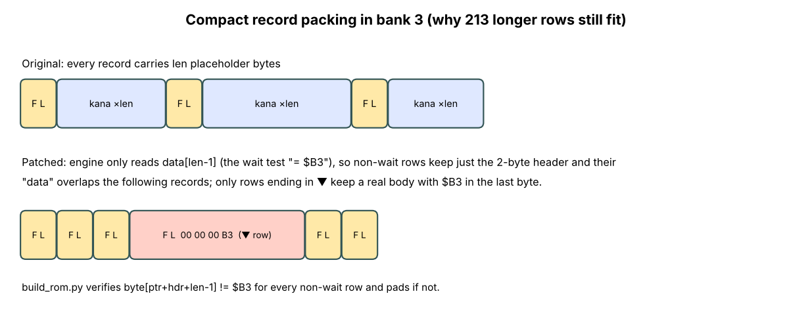

Price rows (154-178) and 元 (186) keep their original full records because they are drawn by the original code.

---

## 11. Shop, status screen, banners

* **Shop**: greetings, "not enough money" and item names are ordinary dialog rows; the cursor price digits are original. (Screenshots in `fig03`.)

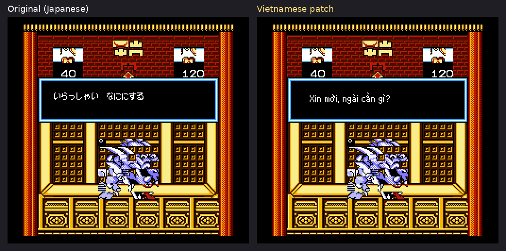

* **Status screen**: labels and item slots are 1 tile-row strips drawn by `draw_small` into `SPOOL` tiles, partitioned per slot (`SLOTS`: label slots 3-4 columns, item slots 5 columns) so nothing needs a run-time allocator. Names must fit the slot (`SMALLMAX` check in the builder).

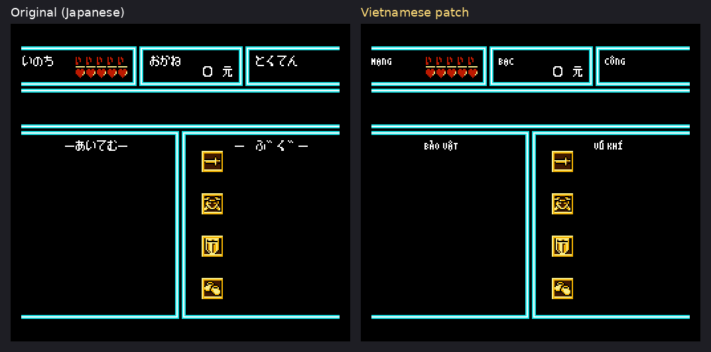
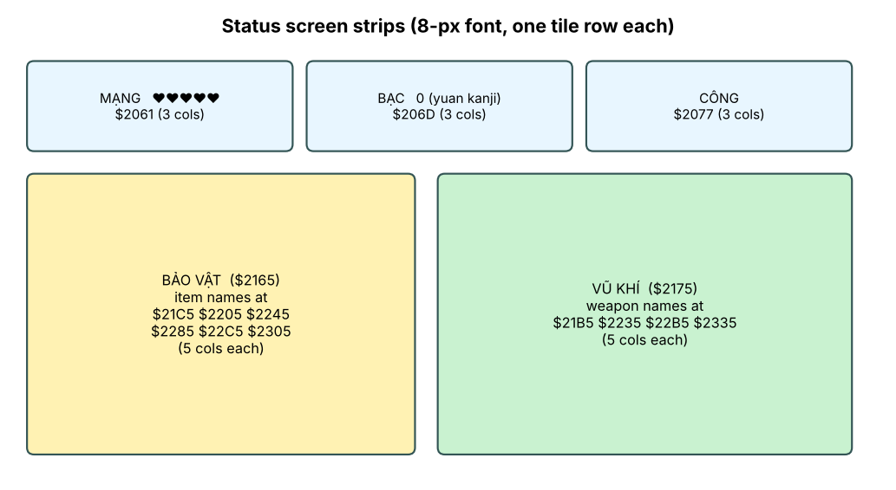

* **Banners (203-212)**: rows with explicit address `$2101`; drawn by `draw_big` as 12-px columns across two tile rows. Not observed in normal play during testing; verified with `tools/poke_hook.mjs` (calls `T_INIT` with `$04/$05 = $2101`).

---

## 12. Title screen

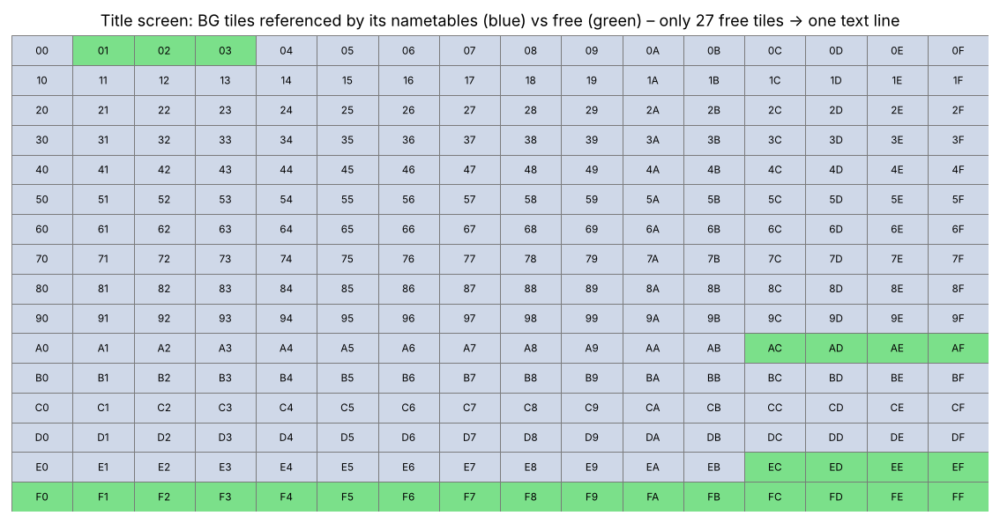

The logo is built from BG tiles `$04-$AB` (a 20×10 gradient of tile ids – generated by code, no raw nametable in ROM, so a static patch was impractical). The title nametable references 229 tiles, leaving **27 free tile ids** (`$01-$03`, `$AC-$AF`, `$EC-$FF`). A 13-column × 2-row text line (26 tiles) fits.

The line is rendered like any other (12-px font) but with a **1-px black outline** (colour 3) around white ink (colour 1) so it reads on the sky background: the 16-row cell has the glyph at rows 2-13. Placement: tile rows 25-26 (`$2329/$2349`), below the copyright block – rows 14-17 are the sprite "walking lane" (the hero and a monster animate there; the first attempt overlapped them).

Run-time: `T_MAIN` in the main loop, state `$FD == 3`; mode 4 uploads 3 tiles per frame (26 patterns), then two 13-byte nametable rows. Bug found on the way: computing `TPAT + X*16` with `ASL/LSR` clobbered the carry between the low and high byte – tiles ≥ 16 were wrong (black squares). Fix: compute the high byte first and add with a preserved carry.


---

## 13. Translation method and glossary

Rules used:
1. **One Japanese row ↔ one Vietnamese row**; structure/flags unchanged. Redistribute text between rows of the same message only if needed.
2. Budget **136 px** (128 px with ▼); the builder prints `row N too wide` otherwise. Typical capacity ≈ 25 characters.
3. Concise, classic-game register; Hán–Việt for titles, places, items and the zodiac hints.
4. Names follow the novel *Tây Du Ký*.

| Japanese | Vietnamese | Note |
|---|---|---|
| ごくう | Ngộ Không (Tôn Ngộ Không) | protagonist |
| さんぞう | Tam Tạng (pháp sư) | |
| はっかい | Bát Giới | Trư Bát Giới |
| ぎゅうまおう | Ngưu Ma Vương | Bull Demon King |
| おしゃかさま | Phật Tổ | |
| にょいぼう | Như Ý Bổng | the staff |
| ちんげんだいせん | Trấn Nguyên Đại Tiên | |
| ようまとう / りゅうのとう | Yêu Ma Tháp / Long Tháp | |
| こうが | Hằng Hà | Ganges |
| ばしょうどう | Ba Tiêu Động | Banana Fan Cave |
| ふうじんのうちわ | Phong Thần Phiến | |
| てんぐのげた | Guốc Thiên Cẩu | |
| おひつじ…うお | Bạch Dương, Kim Ngưu, Song Tử, Cự Giải, Sư Tử, Xử Nữ, Thiên Bình, Thiên Yết, Nhân Mã, Ma Kết, Bảo Bình, Song Ngư | zodiac hints (Hán–Việt names) |
| もんしょう | huy hiệu | |
| すいしょうだま | Thủy Tinh Châu | |

Full per-row table: `docs/translation_table.md`; source of truth: `tools/vi_script.py`.

---

## 14. Testing methodology

All with jsnes, headless:

| Script | What it does |
|---|---|
| `emu.mjs rom "F200,St" prefix` | run frames, screenshot (`S`), dump VRAM (`D`), press buttons (`P`) |
| `replay.mjs` / recorded `work/seq_*.json` | replays recorded inputs to reach a dialog/shop (found by random search) |
| `state_test.mjs`, `ui_test.mjs` | **run the ORIGINAL ROM to the moment before a dialog, save state, load it into the NEW ROM** (after `fromJSON`, reload PRG banks: `mmap.loadRomBank(cpu.mem[0x10],0x8000)` and `loadRomBank(romCount-1,0xC000)`, because `cpu.mem` contains the old ROM bytes) |
| `poke_hook.mjs` | calls `T_INIT` directly with a chosen row/address (banners) |
| `trace.mjs`, `pputrace.mjs`, `callsites.mjs`, `pcsample.mjs`, `ramwatch*.mjs` | memory-access, PPU-write, call-site, PC-histogram and RAM watchers |

Lessons:
* **Input replays diverge** once the patched intro dialog takes different time → use the savestate trick.
* The harness must keep the hero alive (`$34C = 12` invincibility timer) during long runs; `$61B` breaks movement.
* An early "bug" (missing labels on the status screen) was just the queue stalling for ~20 frames – always wait before judging a screenshot.

Verification checklist actually run: every row passes the width check; dialog (2 pages, ▼), shop (greeting/name/no-money), status screen, title; **normal gameplay frame is byte-identical to the original** after leaving the dialog; IPS re-applied to the original equals the built ROM.

---

## 15. Bugs and fixes (chronological)

| Symptom | Cause | Fix |
|---|---|---|
| `pkill -f search.mjs` killed my own shell | pattern matched the shell command | removed |
| False-positive "dialog hit" at boot | PPU writes at `$AAE6` during boot | required frame > 900 and narrower address range |
| Jumping into the shop spawner reset to title | wrong entry/type | found the shop through a randomized replay instead |
| Hero immobile with `$61B` poke | wrong RAM cell | use `$34C = 12` only |
| "0 free RAM bytes" | measured during the boot clear | measured after Start |
| Assembler: *branch out of range* in `entry` | dispatch by `BEQ` to far labels | `BNE` over `JMP` |
| Title tiles black | `ASL…`/`LSR…` clobbering carry | high byte first, then `ADC` with kept carry |
| Title text collided with animated sprites | rows 14-15 are the walking lane | moved to rows 25-26 |
| `T_CLEAR` fell into `T_MAIN` | `LDX #3` followed directly by the next stub | added `BNE common` |
| Status labels unreadable (MỆNH/TIỀN/ĐIỂM) | 8-px font cannot show circumflex+tone clearly | rewrote labels (MẠNG/BẠC/CÔNG) |
| Replay hit the wrong scene | timing changed by new text | savestate method |
| `state_test` crashed at `$B2AA` | `cpu.mem` restored the old ROM image | reload banks after `fromJSON` |
| *(Doraemon, see Part 18)* Yes/No flipped English/Vietnamese | a third copy of the string at `$E212` was not patched | patch every copy, same length |
| *(Doraemon)* wrong NPC gives Shizuka's scene, joins repeatedly | event table count header `03 02 04 08 04` (bank 2 `$813E`) not carried into the rewritten table | copy the 5 count bytes, assert them in the build |
| *(Doraemon)* walking-speed patch v1: NPCs move with the hero | extra scroll call while NPC code compensates `$34` px | v2: change `$34` for the whole frame |
| *(Doraemon)* walking-speed patch v2: NPCs stop between tiles | private NPC step clock `$0450` counts 1 per frame | v3: `$0450 -= $34` |

---

## 16. Address / data reference

| Item | Value |
|---|---|
| Dialog rows | 213, pointers `$9E77`, records `$A021-$A2CB` (patched) |
| Hook sites | bank 3: `$AB96 $AC1B $ACA3 $ACD9 $ACE7`; bank 6: `$81C6` |
| Trampolines | `T_INIT $C03A, T_STEP $C04F, T_BLINK $C053, T_CLEAR $C057, T_MAIN $C05B, common $C080` |
| Window code | `$8000-$8587` (+ `ROWTAB $8600`, rows from `$8640`) in banks 8-14; title data bank 8 `$B800` |
| Dialog text area | nametable `$2147-$2157` (line 0), `$2187-$2197` (line 1), rows 10-13 |
| Pool tiles | `$B0-$B3, $BF-$CA, $CC-$FF` (68) – kept: `$B4-$BD $BE $CB` |
| Free tile ids on title | `$01-$03 $AC-$AF $EC-$FF` |
| Free RAM | `$0491-$04FF` |

---

## 17. Limitations and ideas

* Banner rows (203-212) were never seen in real play; colour/background of that screen unverified.
* Status-screen item names use the cramped 8-px caps; a dynamic tile allocator could allow 12-px names when few items are held.
* Not tested on real hardware; recommended emulators: Mesen, FCEUX (mapper 2, 256 KB).
* Fonts could gain kerning pairs and a bolder variant; translation could be reviewed by a native speaker for tone and idiom.


---

## 18. Second project: what changed for *Doraemon: Giga Zombie no Gyakushuu* (MMC1/SUROM)

The method of parts 1-14 carried over; these are the differences and the extra problems that appeared after testers played the game. (Scripts: `dora/tools/*.js`, speed patch: `dora/speed/`.)

### 18.1 ROM layout
| Item | Original | Translated |
|---|---|---|
| Size | 256 KB, 16 PRG banks, CHR-RAM | 512 KB (header byte 4 = `0x20`) = SUROM |
| Fixed bank | bank 15 at `$C000-$FFFF` | bank 15 **and an identical copy in bank 31** (banks 14/15 copied to 30/31) |
| Bank switch | routine `$CD5C` (A = bank) | `$C0B2` redirected to a SUROM stub at `$FF73` that also sets the 256 KB half |
| Free space in fixed bank | `$FF72-$FFDF` | `$FFA0-$FFDE` (the stub uses `$FF73-$FF9F`) |

### 18.2 Script engine facts used by the fixes
* Message ids `$2E/$2F`, dispatcher `$D8A5`; text tables E/C/A/B/D, E table in bank 3 (VN: bank `$15`), header counts `11 46 24 41 28`.
* Event (C) table: counts `03 02 04 08 04` at `$813E` in bank 2 - **the bug-2 mechanism** (Part 15 table).
* Yes/No strings: three copies; the third at `$E212` is `[S, Có, S, S, Không]` (exactly 10 bytes).
* Menu/title: menu logo alignment (`Doraemon` left-aligned: `$8029/$802A/$802D` in the menu bank, glyph codes `dora[0..5]`), title `©` glyph at `$A2F6/$A31B` of bank 9.

### 18.3 Field (walking) engine - needed for the speed patch
| Address | Meaning |
|---|---|
| `$32` | pixels left in the current 16-px step (16 → 0) |
| `$34` | pixels per frame (1 normal; 2 in some modes) |
| `$35` | sprite / animation id; `$20` direction + step bits; `$45` busy flag |
| `$02/$03/$00` | scroll X, scroll Y, nametable bits |
| `$C5D4-$C633` | field handler in the fixed bank: per frame: `JSR $CF4C, $81A0, $87E2, $8B6F, $CF55`, bank `$0C`, then `LDX $32; JSR $AE22` |
| `$AE22` (bank C) | movement dispatcher; `$AE92` decrements `$32` by `$34` |
| `$81A0 / $81E9` (bank D) | NPC sprite update: moves OAM entries by `$34` (doubled if `$34 ≠ 1`), `$0470 -= $34` |
| `$0450` | **NPC step clock** (16 ticks), `DEC $0450` at bank D `$8BB3` - one tick per call |
| `$0500-$05FF` | OAM buffer (`LDA #$05 / STA $4014`) |
| `$420…` | NPC table: `x tile, y tile, flags, id` (4 bytes each) |

### 18.4 Walking-speed patch v3 (all addresses)
```
C613  JSR $FFA0 ; NOP NOP         (was LDA #$0D / JSR $CD5C)
FFA0  LDA #$0D ; JSR $CD5C
      LDA #0 ; STA $07EA
      LDA $34 ; CMP #1 ; BNE end
      LDA $32 ; AND #2 ; BEQ end
      LDA $0450 ; CMP #1 ; BEQ end
      LDA #2 ; STA $34 ; STA $07EA
end:  RTS
C62E  JMP $FFC5 ; NOP NOP         (was LDX $32 / JSR $AE22)
FFC5  LDX $32 ; JSR $AE22
      PHA ; LDA $07EA ; BEQ + ; DEC $34 ; + PLA ; RTS
D:8BB3  JSR $9E3E                 (was DEC $0450; BNE follows)
D:9E3E  LDA $0450 ; SEC ; SBC $34 ; BCS +2 ; LDA #0 ; STA $0450 ; RTS
```
Result: 16 px in 12 frames (16→15→13→12→11→9→8→7→5→4→3→1→0). The ×2 variant changes the four `LDA #$01 / STA $34` defaults (`$C064`, `$D19B`, bank D `$93FB`, `$941D`) to `#$02` and uses the same NPC-clock fix. Full story and tests: tutorial chapters 23-24, `dora/speed/README.md`.

### 18.5 Test methods added
* Force-message sweep (set `$2E/$2F` to each id and screenshot).
* NPC alignment test: sprite left edge - NPC tile × 16 must be 0 at rest (histogram).
* World-coordinate drift of sprites (`sprite + scroll`) and random-walk screenshots.
* Byte-identical check between apply script output and IPS output; IPS must not extend the 256 KB ROM.
* jsnes savestates garble tiles → replay from boot; consume the pending RESET interrupt (`cpu.emulate()`) before the first measurement.
