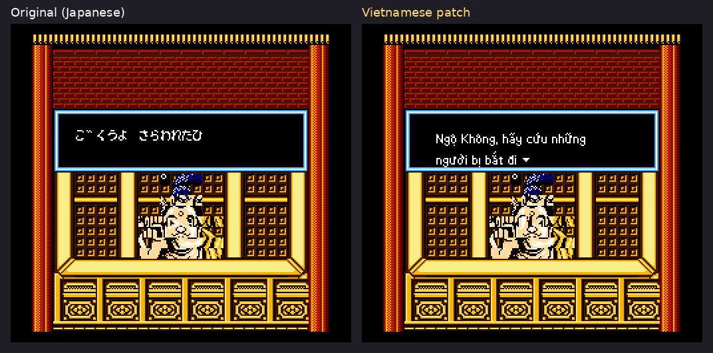
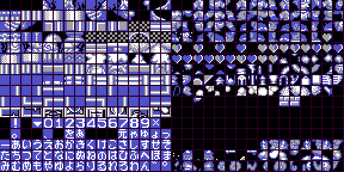
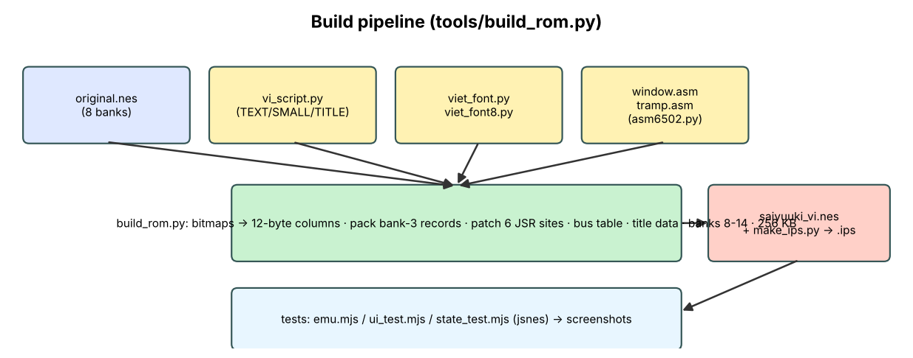
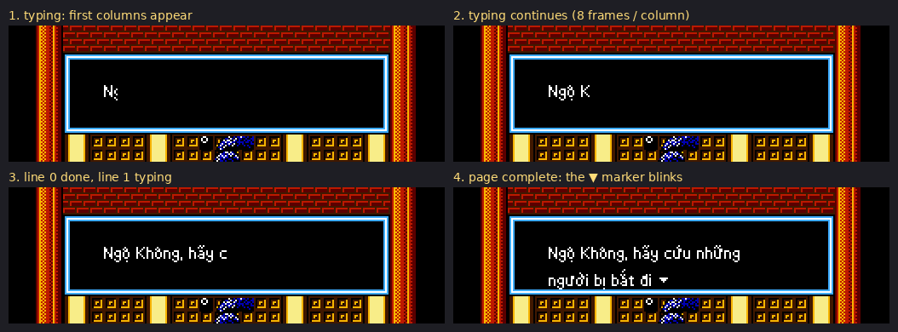

# NES ROM Hacking for Absolute Beginners
### Learning by translating *Saiyuuki World* into Vietnamese

> **Who this is for:** you have never opened a hex editor, or you only know the basics. You do **not** need to know assembly or electronics. You need Python 3 and curiosity.
> **What you will be able to do at the end:** read a NES ROM header, find the graphics and the text, understand why Vietnamese is harder than English to insert, write a patch (IPS), and follow the real project described in `01_TECHNICAL_WALKTHROUGH.md`.
> **Legal note:** only hack ROMs of games you own. Distribute **patches** (IPS), never the ROM itself. Everything here ships as a patch.

---

## Table of contents
1. [What is a ROM, really?](#1-what-is-a-rom-really)
2. [Numbers: binary, hex, and why programmers love $](#2-numbers)
3. [Your toolbox](#3-your-toolbox)
4. [Lab 1 – The 16-byte header](#4-lab-1--the-header)
5. [How the NES shows pictures: tiles](#5-tiles)
6. [Lab 2 – Seeing the graphics](#6-lab-2--seeing-the-graphics)
7. [Text: the "table file" idea](#7-text-and-tables)
8. [Lab 3 – Finding and dumping the dialog](#8-lab-3--dumping-the-dialog)
9. [Why Vietnamese is hard on a NES](#9-why-vietnamese-is-hard)
10. [The big idea: draw the letters yourself](#10-the-big-idea)
11. [Banks and mappers: when 32 KB is not enough](#11-banks-and-mappers)
12. [A 10-minute crash course in 6502 assembly](#12-6502-crash-course)
13. [Lab 5 – Assemble and disassemble](#13-lab-5)
14. [Patching: IPS files (Lab 4)](#14-lab-4--ips)
15. [Mini project: translate one line yourself](#15-mini-project)
16. [Debugging and testing](#16-debugging)
17. [Where to go next / roadmap through the real project](#17-roadmap)
18. [Glossary](#18-glossary)
19. [Cheat sheet](#19-cheat-sheet)
20. [Part II – hunting engine bugs when the translation "works" but the game is broken](#20-hunting-engine-bugs)
21. [Lab 6 – Tables with counts, Yes/No, and the "wrong cat" bug](#21-lab-6--tables-with-counts-yesno-and-the-wrong-cat-bug)
22. [Bigger ROMs: MMC1/SUROM and two copies of the fixed bank](#22-bigger-roms-mmc1surom-and-two-copies-of-the-fixed-bank)
23. [Gameplay patches (walk speed) and why they glitch NPCs](#23-gameplay-patches-walk-speed-and-why-they-glitch-npcs)
24. [Lab 7 – Writing a test that measures the glitch](#24-lab-7---writing-a-test-that-measures-the-glitch)
25. [Delivering patches for more than one ROM](#25-delivering-patches-for-more-than-one-rom)

All commands assume the project folder `saiyuuki/` and that the original ROM is saved as `rom/original.nes` (md5 `01e8594637accca56e7d1a2e63906db5`). Check yours with `md5sum rom/original.nes`.

---

## 1. What is a ROM, really?

A ROM file (`.nes`) is a **dump of a cartridge**: a long list of bytes. A byte is a number from 0 to 255. Nothing else. Every picture, sound, and sentence in the game is some of those bytes, and the game's *program* is also bytes (instructions for the CPU).

```
 file on disk:  4E 45 53 1A 08 00 21 08 ... (thousands more) ...
                └ "NES" + 1A: "I am a NES ROM"
```

The console has:

| Part | Job | Analogy |
|------|-----|---------|
| **CPU** (6502) | Runs the program, 1.79 million tiny steps per second | The brain |
| **PPU** | Draws the screen from tiles | The painter |
| **RAM** (2 KB) | Scratch memory for the game | Whiteboard |
| **Cartridge ROM** | Program + data, read-only | The book |



*Figure 1 – A dialog box: original (left) vs. our translation (right).*

Hacking a ROM = changing some bytes so the game does something different, **without the source code**. For a translation we must change *text*, sometimes *graphics*, and sometimes *code*.

## 2. Numbers

Computers count in binary, humans prefer hexadecimal ("hex"), which is just a compact way to write bytes.

| Decimal | Binary | Hex |
|--------:|-------:|----:|
| 0 | 00000000 | $00 |
| 10 | 00001010 | $0A |
| 16 | 00010000 | $10 |
| 255 | 11111111 | $FF |

* One hex digit = 4 bits (0–F). A byte = 2 hex digits.
* We write hex with a `$` (assembly style) or `0x` (Python style): `$C000 = 0xC000 = 49152`.
* **Address** = a byte's position. The NES CPU sees 64 KB of addresses `$0000–$FFFF`.
* **Little-endian:** a 16-bit number is stored low byte first. Address `$9E77` appears in the file as `77 9E`. This trips up every beginner exactly once.

Try it:
```python
>>> hex(49152), 0x9E77 & 0xFF, 0x9E77 >> 8
('0xc000', 119, 158)
```

## 3. Your toolbox

| Tool | Why | How to get it |
|------|-----|---------------|
| **Python 3.9+** | Our scripts | `python3 --version` |
| **Pillow** | Draw PNGs | `pip install pillow` |
| **Node.js + jsnes** | Headless emulator we script | `git clone https://github.com/bfirsh/jsnes` then `npm i` |
| **A hex editor** (HxD, ImHex, `xxd`) | Look at bytes | any |
| **An emulator with a debugger** (Mesen is excellent; FCEUX too) | Watch the game run, view tiles, set breakpoints | download |
| **Our tools** in `tools/` | `asm6502.py` assembler, `dis6502.py` disassembler, `make_ips.py`, `build_rom.py` | already in the project |

You can follow all labs with only Python + Pillow (+ Node for Lab 2's VRAM dump). A real debugger (Mesen) makes everything ten times nicer; open *Debug → Event/PPU viewer/Tile viewer/Trace logger*.

## 4. Lab 1 – The header

The first 16 bytes of every `.nes` file are the **iNES header**:

```
offset  0-3   "NES" 1A           magic
        4     PRG-ROM size, in 16 KB units
        5     CHR-ROM size, in 8 KB units (0 = the game has CHR-RAM!)
        6     flags: low nibble bits: mirroring, battery, trainer; high nibble = mapper low 4 bits
        7     flags: high nibble = mapper high 4 bits; bits 2-3 = 0b10 means "NES 2.0 format"
        8-15  extras (NES 2.0: sizes, submapper)
```

Run:
```bash
python3 docs/examples/lab1_header.py rom/original.nes
```
Expected for *Saiyuuki World*:
```
PRG-ROM : 8 x 16 KB = 128 KB
CHR-ROM : 0 x 8 KB   (0 => the game uses CHR-RAM: graphics live inside PRG)
mapper  : 2 (UNROM ...)
```
What it tells us:
* **No CHR-ROM** → pictures are *not* in a separate chip; the game copies them into video RAM at startup. That is great news: we can copy **different** pictures (our Vietnamese letters) there at any time.
* **Mapper 2 (UNROM)** → the cartridge swaps 16 KB banks. See §11.


*Figure 2 – Where things live in the 128 KB original and in our 256 KB result.*

## 5. Tiles

The NES screen is 256×240 pixels but it never stores pixels directly. It stores **8×8-pixel tiles** and a **map** saying which tile goes in each cell (32×30 cells = the *nametable*).

Each tile = 16 bytes. Each pixel gets 2 bits = 4 colors. The 16 bytes are two 8-byte "bit planes": plane 0 holds the low bit of each pixel, plane 1 the high bit.


*Figure 3 – Decoding a tile: byte N of plane 0 and byte N+8 of plane 1 combine into row N.*

Worked example. Row bytes `0x3C` (plane 0) and `0x00` (plane 1):
```
0x3C = 0011 1100  → pixels:  . . # # # # . .   (color 1 where bit=1)
```
If plane 1 were `0x3C` too, those pixels would be color 3.

**Consequence for translation:** a letter on the NES is just *one tile*. Japanese kana fit nicely: one kana = one 8×8 tile = one text byte. English needs ~60 tiles. Vietnamese, with its accents, needs far more than the game has room for → §9.

## 6. Lab 2 – Seeing the graphics

Because the game uses CHR-RAM, the graphics are not at a fixed place in the file (they are compressed or stored in PRG and uploaded). The easiest way to *see* them is to run the game and **dump video memory**.

```bash
node docs/examples/lab2_vram_dump.mjs rom/original.nes out.vram 600   # run 600 frames, save 8 KB of pattern memory
python3 docs/examples/lab2_tiles.py out.vram tiles.png 3
```



*Figure 4 – The two 256-tile pattern tables. The right half contains the font: tiles `$B0–$FF` are hiragana.*

Open the picture and count: that block of kana is the entire alphabet of the original game. Tile `$B0` is the first kana; tile number = the **byte used in the text**. That is the key to everything in the next section.


*Figure 5 – After translation, the same pattern memory holds Vietnamese letter fragments.*

## 7. Text and tables

If text is stored as bytes, which byte means which letter? Usually the game's author picked the order of tiles in the font, so byte = tile number. A **table file** records it:

```
B0=あ
B1=い
...
```
You find the table by (a) looking at the tile picture (Lab 2) and (b) checking against known sentences. A common trick: dump the VRAM while a known sentence is on screen, or search for **relative searching** — if "ABC" is stored as 41 42 43 then the *differences* between consecutive bytes are 1,1 whatever the real table. With kana in alphabetical order (あいうえお…) the same trick works.

In *Saiyuuki World*:
* One byte = one kana tile (`$B0–$FF`).
* Voiced marks (゛ ゜) are separate tiles `$FE/$FF` printed after the base letter.
* `$B3` = ▼ ("press a button") and also acts as the terminator in records that wait.

## 8. Lab 3 – Dumping the dialog

Now find the sentences. In this game they are in bank 3, behind a **pointer table**:

```
$9E77:  [lo hi] [lo hi] [lo hi] ...      213 little-endian addresses
           │
           └─►  record: [flags][length]([address])[tile bytes...]
```


*Figure 6 – One text "row" (record).*

```bash
python3 docs/examples/lab3_text.py rom/original.nes 20
```
prints the first 20 rows decoded to kana. Compare with a screenshot of the game: the first intro line should match.

How was the pointer table found? (so you can repeat it on other games)
1. Pick a distinctive sentence on screen; convert it with your table → search the ROM for the bytes. Found at `$A021`.
2. Search the ROM for the **address** of that location in little-endian (`21 A0`). A run of such addresses = the pointer table.
3. Confirm: the table entries ascend and each one points to a plausible record.

## 9. Why Vietnamese is hard

Compare the problem sizes:

| | Japanese kana | English | **Vietnamese** |
|--|--:|--:|--:|
| Distinct glyphs needed | ~80 | ~60 | **~134** (a, ă, â, à, á, ả, ã, ạ, ằ, ắ, ẳ ...) |
| Typical width | 8 px, fixed | 8 px | proportional is needed to fit |
| Text per line | 17 kana | 17 chars | **same box, more letters** per sentence |

Three problems:
1. **Tone marks and vowel marks stack** (ệ = e + ^ + dot below). An 8×8 tile has no room above and below.
2. **Not enough tiles.** The pattern table holds 256 tiles and the game uses most for pictures.
3. **Vietnamese sentences are longer** than the Japanese ones. The box is 2 lines × 17 characters.

"Just replace kana with Latin letters" would give you text without tone marks. The user demanded full tones, so we needed a different approach.


*Figure 7 – Our solution: a 12-pixel-tall glyph cell. Upper area for diacritics, x-height middle, lower area for dot-below and descenders.*

## 10. The big idea

> **Stop thinking of the text as bytes → tiles. Pre-render each sentence into pixels, then cut those pixels into tiles that are uploaded on demand.**

Steps (details: Walkthrough §§4–8):

1. For every translated sentence, render it with a **proportional bitmap font** (letters 3–7 px wide) so it fits 2 lines × 17 tile-columns = 136 px.
2. A line is 12 pixels tall; the screen's tile is 8 pixels tall, so each text column uses **two tiles** (top 8 rows, bottom 4 rows + the box border).
3. Cut the bitmap into 8×8 chunks, remove duplicates (many are empty), and give each chunk a tile number from a **pool of 68 free tiles**.
4. When the game wants to show the sentence, a patch of ours (running on the CPU) **uploads those chunks into VRAM** and writes the right tile numbers to the nametable.



*Figure 8 – The build pipeline: translation script → bitmaps → tile chunks → patched ROM.*



*Figure 9 – Frames of the finished game typing out a Vietnamese line.*

Because the game's own routine only draws kana tiles, we **hook** it: the original code calls our code at four points (init, step, blink, clear) and we draw instead.


*Figure 10 – Where our code takes over from the original.*

## 11. Banks and mappers

The CPU only sees 64 KB, and half of that is RAM/hardware. The cartridge gives:
```
$8000-$BFFF  16 KB window  ← switchable bank (UNROM: choose any of N banks)
$C000-$FFFF  16 KB fixed   ← always the LAST bank
```
Switching = write the bank number to a ROM address. A quirk of UNROM ("bus conflict"): the ROM chip also drives the data bus, so you must write to an address that **already contains the same number**. Game authors store a table `00 01 02 03 ...` for that; we made a bigger one.


*Figure 11 – CPU memory map.*

Why this matters for us: the original had 8 banks (128 KB), and the text-engine bank was full. Vietnamese text lives in **seven new banks** (we grew the ROM to 256 KB). The fixed bank had ~220 free bytes for our trampoline, so every new routine is placed in a swappable bank and a tiny stub in the fixed bank switches to it, runs it, and switches back.

## 12. 6502 crash course

You can read 6502 code after learning ~15 instructions. It has three registers: **A** (accumulator), **X**, **Y**; a stack; and flags (Z zero, C carry, N negative).

| Instruction | Meaning |
|---|---|
| `LDA #$05` | A = 5 (`#` = literal number) |
| `LDA $0300` | A = byte at address $0300 |
| `LDA $0300,X` | A = byte at $0300+X |
| `STA $0300` | store A to $0300 |
| `LDX/LDY`, `STX/STY` | same for X, Y |
| `INX DEX INY DEY` | +1 / −1 |
| `CLC` / `ADC #n` | clear carry; A = A + n + carry |
| `SEC` / `SBC #n` | A = A − n − (1−carry) |
| `CMP #n` `CPX` `CPY` | compare (sets flags, no change) |
| `BEQ / BNE label` | branch if equal (Z=1) / not equal (Z=0) |
| `BCC / BCS label` | branch if carry clear / set |
| `JMP addr` | go to |
| `JSR addr` / `RTS` | call subroutine / return |
| `PHA / PLA` | push/pull A on stack |
| `LSR A`, `ASL A` | shift right / left (÷2, ×2) |
| `AND #n`, `ORA #n` | bit mask / bit set |

Reading example:
```
        LDX #$10        ; X = 16
loop:   STA $0300,X     ; write A at $0300+X
        INX             ; X = X + 1
        CPX #$20        ; X == 32 ?
        BNE loop        ; no → repeat
        RTS
```
It fills 16 bytes. **Every loop in game code looks like this.**

How do you find the *text* routine in a program of 100 KB? **Work backwards from a result you can see.** The pointer table address `$9E77` (Lab 3) appears in code exactly once, in the routine that loads a row. Find the code that reads it: start at the reference, follow the logic. We used an emulator trace + the ability to ask "which instruction wrote to PPU `$2007`?". See Walkthrough §5.


*Figure 12 – The dialog engine as a state machine (what we found).*

## 13. Lab 5

```bash
python3 docs/examples/lab5_asm.py
```
It assembles the loop above with `tools/asm6502.py`, prints the bytes, and disassembles them back with `tools/dis6502.py`. Change `$0300` to `$0400`, rerun: only the operand bytes change. That is all a patch is.

## 14. Lab 4 – IPS

IPS is the simplest patch format:
```
"PATCH"  { offset(3 bytes) size(2 bytes) data }*  "EOF"
```
```bash
python3 docs/examples/lab4_ips.py
```
creates a fake ROM, patches it, and verifies. Real use: `python3 tools/make_ips.py rom/original.nes build/saiyuuki_vi.nes build/saiyuuki_vi.ips`. IPS records may extend the file, so our 256 KB result is still one small patch.

Apply with any patcher (Floating IPS, `flips`) onto an **unmodified** ROM (check md5!).

## 15. Mini project

Goal: change the first dialog to say something else, using only a hex editor and Lab 3's table.

1. Run Lab 3 and note the address (file offset) of row 0's text. File offset = 16 (header) + bank×$4000 + (address − $8000).
2. Pick a record with `flags` `$80` (waits for a button). Keep the **length byte** the same, or *shorter* text with `$B3`.
3. Overwrite the kana bytes with others from the table. For example turn "ありがとう" into another kana word of the same length.
4. Save as a **new file**, open in the emulator. The line changes.
5. Bonus: change only the length byte (+1) and see the text engine print one more tile — a garbage tile — proving the length byte matters.

*Why can't we simply type "Xin chào"?* Because there are no Latin tiles in the pattern table and no tile for "à". That is the whole reason this project needs §10.

Mini-project 2 (pixel art): in the VRAM dump, find the kana あ. Convert the 16 bytes by hand into pixels (Figure 3). Draw a "Đ" in a free tile and write its 16 bytes — you have created your first font glyph.

## 16. Debugging

| Symptom | Likely cause | Fix |
|---|---|---|
| Game freezes on boot after you edit code | Wrong bank-switch / forgot bus-conflict table | restore ROM, change one thing at a time |
| Garbled tiles in dialog | Tile numbers outside pool, or upload not finished before display | Check pool map (Fig. 14 in the walkthrough) |
| Text clipped / misaligned | Sentence wider than 136 px | `build_rom.py` prints "row N too wide" → shorten |
| Crash only in emulator X | Bus-conflict ignored in some emulators | use the bus-conflict-safe bank switch |
| Palette wrong | Attribute table not updated | check nametable attribute bytes |
| A menu shows English words mixed with yours | A second copy of the string exists (several tables, e.g. Yes/No drawn from different places) | search the *original* ROM for every copy (Lab 6) |
| The wrong character speaks / the wrong event runs after you moved a text bank | A lookup table has a **count/header** that was not moved with the text | compare header counts of the original and the new ROM (Lab 6) |
| A patch works on the original ROM but crashes on the translated ROM | The translated ROM has a second copy of the fixed bank, or bytes you assumed free are used | check free space in **both** ROMs, patch every copy (chapter 22) |
| Sprites (NPCs) drift, overlap walls, or look "broken" after a gameplay patch | You changed one per-frame variable that other routines (or private timers) also depend on | chapter 23 |

Habits that save days:
* **Always keep the original** and build from it by script (never hand-edit the only copy).
* Change **one thing**, test, commit a copy.
* Make a **savestate** right before the scene you test (our `state_test.mjs`).
* Print numbers in hex, always.
* Write down every address you learn. Your notes *are* the project.

## 17. Roadmap

Read in this order:
1. This tutorial (labs 1–5).
2. `01_TECHNICAL_WALKTHROUGH.md` — the full real project, with every address.
3. `docs/translation_table.md` — the Japanese → Vietnamese sentences with the Sino-Vietnamese choices.
4. `docs/APPENDIX_source.md` — the source code.
5. Try the method on another small UNROM game: dump the header, dump the pattern tables, find a sentence, find its pointer, and write down the engine.

Suggested exercises of rising difficulty: (a) change a price in the shop; (b) swap two items' names (same length); (c) make a one-byte patch to change the text speed (the 8-frames-per-column constant); (d) add a second text line style; (e) port the font to another game.

## 18. Glossary

| Term | Meaning |
|---|---|
| **ROM** | read-only memory; the cartridge's contents |
| **iNES header** | the 16 bytes at the start of `.nes` |
| **PRG** | program ROM (code and data) |
| **CHR** | character (graphics) memory; CHR-RAM can be written at run time |
| **Mapper** | cartridge hardware that switches banks |
| **Bank** | one switchable chunk of ROM |
| **Bus conflict** | writing to ROM while the ROM outputs data; value must match |
| **Nametable** | 32×30 map of tile numbers = what is on screen |
| **Pattern table** | the tile pixel data |
| **2bpp** | two bits per pixel |
| **PPU** | picture processing unit |
| **NMI** | interrupt at each frame (60/s), when drawing is safe |
| **Pointer** | address stored as data |
| **Little-endian** | low byte first |
| **Hook** | replacing a call so your code runs instead |
| **Trampoline** | small routine that switches bank, runs code, switches back |
| **IPS** | simple patch format |
| **Savestate** | frozen snapshot of the emulator |
| **Dakuten** | the ゛ voiced mark |
| **Sino-Vietnamese (Hán-Việt)** | Vietnamese words derived from Chinese readings, e.g. *Tây Du Ký* |

## 19. Cheat sheet

* Header: `NES 1A, PRG×16K, CHR×8K, flags6, flags7`. Mapper = `(f7 & F0) | (f6 >> 4)`.
* File offset of bank *b* address *a* (window): `16 + b*0x4000 + (a-0x8000)`. Fixed last bank: same with `b = last`.
* Tile bytes: `plane0[0..7], plane1[0..7]`; pixel `= bit(p0)|bit(p1)<<1`.
* PPU registers: `$2006` (address ×2), `$2007` (data), `$2000/2001` control.
* To find text: relative search → pointer table → engine.
* Keep a build script. Always.
* Tables often start with **counts**; carry them along and assert them in the build.
* Before changing a per-frame variable, find **every** reader/writer in **all** banks, and any private timers.
* Test with **invariants** (drawn sprite position = logical tile position), not by eye only.
* Fixed bank changes go into **every copy** of the fixed bank; one IPS per ROM; translation first, gameplay patch second.

You are ready for the real thing: open `01_TECHNICAL_WALKTHROUGH.md`.

---

# Part II – Beyond the text

Chapters 1-19 got the text on screen. Real projects do not end there: testers will find broken menus, wrong events and glitches. The next chapters come from the second project (*Doraemon: Giga Zombie no Gyakushuu*, 256 KB → 512 KB ROM) and from a **walking-speed patch** that went wrong three times before it went right. They are written as lessons: what we saw, what we guessed, what was actually true.

## 20. Hunting engine bugs

**Rule 1 – "the text is in" is not "the game works".** The text engine is only one of many tables the game reads. When you move, resize or re-encode text you may break something that does not look like text at all.

**Rule 2 – a bug report is a clue; find the *mechanism*.** Two reports from the Doraemon project:

| Report | Obvious guess | Real mechanism |
|---|---|---|
| Choices flip between `YES/NO` and `Có/Không` | "I forgot one string" | The game draws Yes/No from **several** copies and one of them (third string at `$E212`) was never patched. |
| Talking to the cat adds *Shizuka* again and again | "The dialog is wrong" | The event is selected by a **table with a count header**. After the translation tool rewrote the table, the 5 count bytes (`03 02 04 08 04`) pointed at the wrong group, so entry *n* of one group was read as entry *n* of another. |

How to approach a new bug in 5 steps:

1. **Reproduce it in the emulator and write down the exact input path** (a replay script, see chapter 24). A bug you cannot reproduce cannot be fixed.
2. **Compare with the original ROM** along the same path. If the original behaves correctly, the cause is in *your* diff - `cmp -l original.nes yours.nes` lists every changed byte; group them by bank.
3. **Find the code that decides**: watch the RAM variable that changes (`which character joined?`) and find who writes it (emulator breakpoint or a RAM-watch script).
4. **Fix at the lowest level** (a byte in a table), not by special-casing in your own code.
5. **Re-test the original symptom and the neighbours** (other characters, other towns). Then **audit**: look for the same *class* of bug elsewhere (all tables with counts, all strings drawn twice).

## 21. Lab 6 – Tables with counts, Yes/No, and the "wrong cat" bug

**Goal:** learn to spot tables that depend on a *count* and strings that exist in several copies.

1. **Find all copies of a string.** Convert the English/Japanese `Yes`/`No` to tile codes with your table and search *every bank* of the original ROM:
   ```
   node tools/find.js original.nes "<hex bytes of Yes/No>"
   ```
   Expect more than one hit (one per menu type). Patch **all** of them; keep the *length* identical (pad with the blank tile) because other code reads fixed offsets.
2. **Look for headers before tables.** Disassemble the routine that reads the table and see what it does with the first bytes. In Doraemon the event lookup (`$D915`) uses a header of five counts at `$813E` in bank 2. Rule of thumb: **if a table is preceded by small numbers that add up to the table size, they are counts.**
3. **Make your build tool carry the counts along** and add an **assertion**:
   ```js
   rom.expect(2, 0x813E, '03 02 04 08 04');   // original header
   ... rewrite the table ...
   assert(counts equal original counts)        // fail the build, never ship silently
   ```
4. **Force-test every message**: a small script that sets the "message id" RAM variable to each value (0…N) and screenshots the box. That finds untranslated or wrongly linked entries in minutes. We call this the *force-message sweep*.
5. **Look at menus with fresh eyes** (alignment, `©` mark in the title, left-aligned labels): many "bugs" reported by testers are cosmetic. Collect them in `docs/BUGFIXES.md` with: symptom, cause, fix, how it was verified.

## 22. Bigger ROMs: MMC1/SUROM and two copies of the fixed bank

Section 11 showed UNROM (switchable bank at `$8000`, last bank fixed at `$C000`). Many games use **MMC1** (mapper 1). With **SUROM** (512 KB) two things change:

* A bank-select value only selects **within a 256 KB half**; the *other half* is chosen by a bit of a different register (the CHR bank register). Your bank switch routine must write both.
* The CPU always sees the **fixed bank at `$C000`** of the *currently selected half*. So when you want code to run from both halves you need **two identical copies of the fixed bank** (banks 15 and 31 in our ROM).

Consequences you must remember forever:

1. Any change to the fixed bank (a hook, a new routine) must be applied to **both copies**. We always write a helper `forEachFixed(bank => patch(bank))`.
2. The original ROM (256 KB) has only one copy. A patch that is meant for both ROMs has to know which one it is looking at: the iNES header byte 4 tells you (16 = original, 32 = expanded).
3. Free space can differ. Always check `0xFF` runs in *both* ROMs and use only the intersection (in Doraemon: `$FFA0-$FFDE`; the translation uses `$FF73-$FF9F`).
4. Test in an emulator that supports the mapper you chose; the headless test harness (jsnes) needed custom SUROM handling.

## 23. Gameplay patches (walk speed) and why they glitch NPCs

A "small" gameplay patch is a great way to learn how a game is *really* built - and how fragile it is. Goal: **make the hero walk about 1.33× faster**, as a separate patch that works on the original and translated ROM.

**What we knew:** the hero walks in 16-pixel steps. Each frame a routine scrolls `$34` pixels (normally 1) and subtracts it from a counter `$32` (16 → 0). So a tile takes 16 frames.

**Attempt 1 (v1) - "give some frames an extra pixel".** Call the movement routine twice on every frame whose counter has bit 1 set. The hero, scroll and Doraemon looked perfect (16 px in 12 frames). In-game testers reported: NPCs follow the hero, stand over houses and trees, sprites look broken.

> **Why:** the *NPC routines run before the extra call* and assume the world moves `$34` pixels per frame. On bonus frames the screen scrolled 2 px, the NPC code compensated 1 px: every bonus frame moved NPCs 1 px relative to the map. Errors accumulated.

**Attempt 2 (v2) - "change the step size, not the number of calls".** Set `$34 = 2` for the whole frame before the NPC routines run and put it back afterwards. Scroll and NPC compensation agree now. Testers: *better, but NPCs still overlap houses and start walking together.*

> **Why:** NPCs have their **own step clock** (`$0450`, 16 ticks) that counts down by exactly 1 per frame (`DEC $0450`), and the NPC routines only run while the hero is walking. A 12-frame hero step gave each NPC only 12 of its 16 ticks, so NPCs stopped half-way between tiles and later started their next step all together.

**Attempt 3 (v3) - fix every consumer.** Replace `DEC $0450` with `$0450 -= $34` (a tiny routine in free space) and refuse a 2-pixel frame when the NPC clock has exactly 1 tick left (it would overshoot by 1 px).

**Lessons you can reuse anywhere**

| Lesson | Detail |
|---|---|
| Find **all readers and writers** of a variable before changing it | `grep` the whole ROM (all banks) for the address in every addressing mode: zero page `85 34`, `A5 34`, absolute `8D 50 04`, … |
| Look for **private timers** that run at their own rate | A counter that is decremented by 1 per frame regardless of speed is a warning sign. |
| Two kinds of "speed" exist | pixels per frame (`$34`) and frames per step; keep them in the same ratio everywhere. |
| Do not make a one-frame exception that only part of the engine sees | Everything that runs in a frame must see the same world. |
| Keep a **flag** for "I changed it, so I must restore it" | Our patch uses a free RAM byte (`$07EA`, verified never used by the ROM) to remember the boost. |
| Use the engine's own supported value (`$34 = 2` is used for other modes) rather than inventing new semantics | We reused the doubling the game already does when `$34 ≠ 1`. |
| Hook where the whole frame passes | Two hooks (before NPC routines, after movement) and one data fix. |

## 24. Lab 7 - Writing a test that measures the glitch

"It looks fine" is not a test. Build a measurement.

1. **Make the emulator reproducible.** Use a headless emulator (jsnes), start from boot, and replay a script: `Hr:150` (hold right 150 frames), `A:3`, `F30` (wait 30 frames). Avoid savestates in jsnes (they garble tiles); replay from boot.
2. **Find the hardware-visible state.** Sprite RAM (OAM) is a 256-byte buffer copied to the PPU every frame. In Doraemon it lives at `$0500` (`LDA #$05 / STA $4014`). Each sprite: `y, tile, attribute, x`.
3. **Convert to world coordinates**: `world_x = sprite_x + scroll_x (+256 if nametable bit)`. An NPC that stands still must have a constant world position while the hero walks.
4. **Find the game's logical state**: Doraemon keeps NPC tile coordinates in a table at `$420` (x, y, flags, id). The *drawn position must equal the logical tile × 16* once the NPC has stopped.
5. **Write the invariant as code** and print a histogram:
   ```
   offset = sprite_left_edge - tile_x*16          # must be 0 at rest
   original ROM:   mostly 0
   v1 patch:       0, 4, 8, -12, -4 ...   (broken)
   v3 patch:       0 almost everywhere
   ```
6. **Compare against the unmodified ROM with the same measurement**, never against "perfect". The test itself has noise (neighbouring NPC picked by mistake, NPC caught mid-step) - the *original* ROM shows some too.
7. **State what you did not test** (other towns, vehicles, hardware). Honest limits are part of the deliverable.

A random-walk test (`wander`) that drives the hero in random directions and saves screenshots every few segments is cheap and catches things your scripted routes miss.

## 25. Delivering patches for more than one ROM

* **Order matters.** Translation patch first, gameplay patch second (the translation patch would overwrite the second fixed-bank copy otherwise).
* **IPS limits.** An IPS record that writes beyond the end of the original file *enlarges* it; the Japanese ROM (256 KB) must not receive records for the 512 KB bank copies. Ship one IPS per ROM (`walkspeed_JP.ips`, `walkspeed_VN.ips`).
* **Ship an apply script too** that detects the ROM type (header byte 4), verifies the expected bytes before writing, refuses already-patched ROMs, and supports variants (`--x2`). Test that its output is **byte-identical** to the IPS result.
* **Document every address** (hooks, free space used, RAM byte used) in the README, plus the tests and the open issues.
* **Version your patches** (v1, v2, v3) and keep a changelog of *why* each version changed: the history above is more instructive than the final code.

